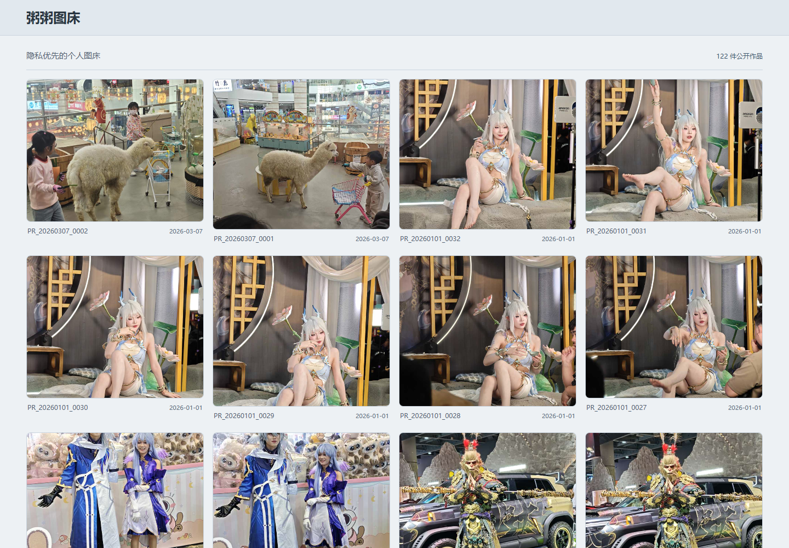
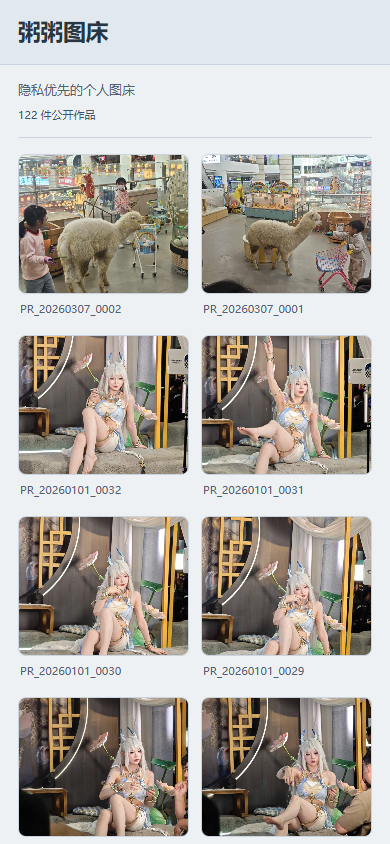

# PIMG

隐私优先的自托管图床，管理图片、视频与相册，按需公开和分享。

[](https://hub.docker.com/r/posase/pimg)
[](https://hub.docker.com/r/posase/pimg/tags?name=v1.0.37)
[](https://www.posase.net/)

[在线演示](https://www.posase.net/) · [快速部署](#快速开始) · [使用说明](docs/usage.md) · [存储配置](docs/storage-guide.md) · [部署与升级](docs/deployment.md) · [问题反馈](https://github.com/jesongit/pimg/issues)

PIMG 将文件管理与公开展示分开：上传后先归档，再由你决定是否公开缩略图、生成永久外链或使用临时链接。支持本地目录、Telegram 和 Cloudflare R2，可组合多份归档，保留原件与各存储副本的实际状态。

## 界面预览

公开首页，截图来自[演示站](https://www.posase.net/)；站点名称、介绍和页脚可在后台自定义。



<details>
<summary>查看手机端效果</summary>



</details>

## 功能

| 功能 | 说明 |
| --- | --- |
| 图片与视频 | 支持 JPEG、PNG、WebP、HEIC/HEIF，以及 MP4、MOV、MKV、WebM 等格式；提供缩略图、媒体信息和兼容查看。 |
| 图库与相册 | 按用户、相册、类型、状态、加密设置筛选；支持日期时间轴、批量整理、上传及服务器文件导入。 |
| 文件浏览 | 管理员按文件夹浏览或展开图片和视频，按名称、类型、大小及创建／修改时间排序；可指定目录建立监听索引，默认关闭；源文件只读，可选择复制导入。 |
| 多用户 | 管理员创建账号，普通用户管理自己的文件和相册；存储连接和公开授权由管理员统一管理。 |
| 多存储归档 | 本地、Telegram、Cloudflare R2 可按用途组合；支持后台补齐、故障降级、恢复与逐存储状态查看。 |
| 公开与分享 | 可按文件或相册公开首页缩略图，支持批量公开及单独隐藏；原件永久发布、临时链接分别管理。 |
| 图片与视频查重 | 扫描当前筛选的全部结果，识别相似图片、筛选同大小视频；提供人工核对与保留建议，删除仍需确认。 |
| 安全与恢复 | 支持按存储能力加密归档、可选 TOTP 两步验证、API 令牌、任务重试和整站迁移。 |

### 公开范围

- **首页公开**只开放缩略图；视频也只展示静态封面，不因此开放原图、原视频播放或原件下载。
- **公开相册**内可以单独隐藏某个文件；单独公开的文件不会随相册取消公开而撤销。
- **永久发布**用于公开原件外链，与首页公开独立；取消首页公开不会撤销已有永久外链。
- **加密归档**由服务端管理密钥并按授权解密，属于服务端加密，不是端到端加密。

## 快速开始

推荐使用 Docker。当前正式镜像为 **`posase/pimg:v1.0.37`**，支持 **`linux/amd64`**；镜像已包含 FFmpeg、FFprobe 和 HEIC 预览工具。

以下命令使用本地存储，可先体验，再在后台配置 Telegram 或 R2：

```sh
docker run -d \
  --name pimg \
  --restart unless-stopped \
  -p 127.0.0.1:8787:8787 \
  -v pimg-data:/pimg/data \
  -v pimg-runtime:/pimg/runtime \
  -e PIMG_COLD_STORAGE=local \
  -e PIMG_HOT_STORAGE=local \
  posase/pimg:v1.0.37
```

1. 打开 <http://127.0.0.1:8787>，点击首页介绍或页脚后台入口，也可直接访问 `/login`。
2. 首次使用以 `admin / admin` 登录，按页面提示设置新密码；可通过 `PIMG_ADMIN_USERNAME` 和 `PIMG_ADMIN_PASSWORD` 指定初始账号。
3. 在「存储」确认归档用途，再到「图库」上传图片或视频。
4. 需要公开展示时，由管理员在详情、批量操作或相册页点击「公开」。

全新站点尚无公开作品时，可直接访问 `http://127.0.0.1:8787/login`。公网部署请通过 HTTPS 反向代理接入，再在后台填写站点公网地址。

### Docker Compose

```sh
git clone https://github.com/jesongit/pimg.git
cd pimg
cp config.example.yaml config.yaml
```

在项目目录新建 `.env`，先使用本地存储：

```dotenv
PIMG_COLD_STORAGE=local
PIMG_HOT_STORAGE=local
```

```sh
docker compose up -d --no-build
```

Compose 默认对外绑定 `8787` 端口；请根据部署环境调整 `ports`、反向代理及访问范围。数据保存在项目目录的 `data/`，运行缓存位于 `runtime/`。更多环境配置见[部署指南](docs/deployment.md)。

## 存储选择

| 提供方 | 归档 | 永久发布 | 临时存储 |
| --- | --- | --- | --- |
| 本地目录 | 支持 | 支持 | 支持 |
| Telegram | 支持 | — | — |
| Cloudflare R2 | 支持 | 需公开域名 | 支持 |

归档可选多个实例；永久发布和临时存储各选一个首选。Telegram 由管理员统一登录，每个用户分配独立群、相册对应话题，普通用户无需配置 Telegram。

完整原件保留原字节；视频归档可按存储设置保存无损片段。兼容查看生成的派生文件不覆盖原件。存储配置、目录挂载、加密与视频分片说明见[存储指南](docs/storage-guide.md)。

## 升级与备份

升级时继续使用原数据卷、运行卷、配置和启动参数，只替换镜像并重建容器。**不要删除或重新初始化数据卷。**

`/pimg/data` 保存数据库、主密钥、Telegram 会话、本地存储及待完成上传；`/pimg/runtime` 保存可重建的预览和运行缓存。数据库必须与**原主密钥**一起备份，外部本地存储目录也需单独保留。

详细步骤见[部署与升级](docs/deployment.md#升级已有实例)，本次变化见 [v1.0.37 更新说明](docs/releases/v1.0.37.md)。

## 文档与开发

| 文档 | 内容 |
| --- | --- |
| [使用说明](docs/usage.md) | 上传、相册、公开、查重、批量操作和账号权限 |
| [部署与升级](docs/deployment.md) | Docker、Compose、配置、反向代理、备份和升级 |
| [存储指南](docs/storage-guide.md) | 本地目录、Telegram、R2、加密与视频分片 |
| [开发说明](docs/development.md) | Go / React 技术栈、本地构建和测试 |

后端使用 Go + SQLite，前端使用 React + TypeScript + Vite，生产前端嵌入 Go 程序。无需 Redis 或独立消息队列。

遇到问题可[提交 Issue](https://github.com/jesongit/pimg/issues)，请附版本、部署方式、复现步骤和脱敏日志。
